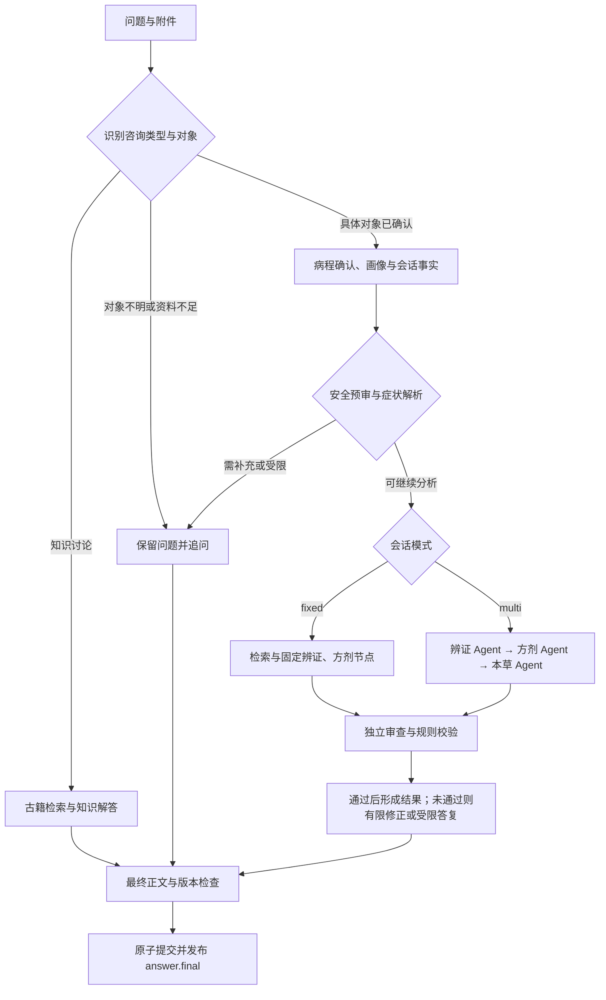

# 岐问 QiWen

**让中医知识问答有出处，让多轮咨询有上下文。**

岐问是面向学习与研究的中医知识问答与会诊流程演示项目。它将古籍检索、问诊信息整理、辨证与方剂知识分析串联起来，提供从资料输入、追问补充到审查后答复的完整交互。你可以查阅经典、携带文本资料提问，也可以观察固定工作流与多 Agent 如何调用工具、核对证据并形成结果。

项目默认使用 Mock 演示，可接入 OpenAI 兼容模型服务。系统输出仅供学习和研究参考，不能替代执业中医师面诊，请勿据此自行诊断、抓药或调整用药。

[快速开始](#快速开始) · [问答流程](#问答流程) · [知识与数据](#知识与数据) · [开发与验证](#开发与验证) · [文档导航](#文档导航)

## 可以用岐问做什么

- **带着出处查知识**：检索内置中医古籍，结合书名、章节和原文片段阅读答复；真实知识回答核对引用是否来自本轮检索。
- **连续补充问诊信息**：同一会话保留症状、病程与待答问题，区分本人咨询、替他人咨询和纯知识讨论，长间隔续问时按需确认病程。
- **比较两种处理流程**：`fixed` 按预设节点推进；`multi` 由辨证、方剂、本草 Agent 依次调用受限工具，外层工作流统一负责预审、结果检查与提交。
- **管理自己确认的画像**：手填体质、过敏史等资料；从对话中提取的长期资料经确认后保存，可查看来源和撤销。其他会话的症状、附件及自动摘要不会进入当前回答。
- **结合附件提问**：支持带文本的 PDF、DOCX 与 UTF-8 TXT。单文件最多 10 MB、提取文本最多 20000 字符，单轮最多 5 个附件；暂不支持扫描 PDF OCR。
- **查看处理进度与结果**：聊天页通过 SSE 展示处理阶段，支持停止生成、恢复历史、重命名和删除会话；最终正文以服务端确认的 `answer.final` 为准。
- **连接只读知识工具**：可选 MCP 服务提供知识查询与本人画像读取，画像访问受身份、权限和审计约束。

## 技术组成

| 部分 | 当前实现 |
| --- | --- |
| 前端 | Next.js 16、React 19、TypeScript、Tailwind CSS 4 |
| 页面状态与数据请求 | Zustand、TanStack Query |
| 后端接口 | FastAPI、Pydantic、Uvicorn，JWT 鉴权与 SSE 事件 |
| 工作流与 Agent | LangGraph，固定流程与受限工具调用子图 |
| 模型接入 | Mock / OpenAI 兼容接口，支持按角色配置模型 |
| 古籍检索 | BM25、可选 Chroma 向量召回、RRF 融合 |
| 证据筛选 | 本地 CrossEncoder 重排、相关性门槛与 MMR 去重选取 |
| 数据存储 | SQLite 业务库与 LangGraph 检查点库 |
| 部署与验证 | Docker Compose、pytest、Vitest、ESLint |

## 快速开始

以下命令使用 PowerShell，在项目根目录执行。推荐安装 Docker 与 Docker Compose；容器内使用 Python 3.12 和 Node.js 22，无需在宿主机另行安装这两套运行环境。

### 1. 选择模型模式

默认 `mock` 可用于观察界面、工具与流程，不需要聊天 API 凭据，也不代表真实模型的回答质量。

需要真实回答时，将 [.env.example](.env.example) 复制为本地 `.env`（已有文件请直接编辑），按模型服务提供方填写：

| 配置项 | 用途 |
| --- | --- |
| `QIWEN_MODEL_MODE` | 设置为 `openai_compatible` 启用真实聊天 |
| `QIWEN_MODEL_BASE_URL` | 兼容模型服务的接口基址 |
| `QIWEN_MODEL_API_KEY` | 仅服务端使用的访问凭据 |
| `QIWEN_MODEL_NAME` | 服务提供方支持的模型名称 |
| `QIWEN_MODEL_<ROLE>` | 可选，为不同角色指定模型 |
| `QIWEN_EMBEDDING_MODEL` | 可选，启用古籍向量检索所需的嵌入模型 |

不要提交 `.env` 或在日志、截图、命令输出中展示密钥。生产环境的签名密钥、超时和其他配置见 [部署说明](docs/deployment.md)。

### 2. 启动并检查服务

```powershell
docker compose up --build -d
docker compose ps
Invoke-RestMethod http://127.0.0.1:23000/api/health
(Invoke-WebRequest http://127.0.0.1:23000/chat -UseBasicParsing).StatusCode
```

确认 `backend` 与 `frontend` 均为 `healthy`，健康接口返回 `status=ok`，聊天页返回 HTTP 200。

### 3. 准备检索模型

默认古籍检索启用本地重排，首次部署需要显式下载模型，耗时取决于网络和设备：

```powershell
docker compose exec backend python -m scripts.prepare_ranking
```

聊天 Mock 与本地检索模型相互独立。默认请求 `hybrid` 检索，未配置嵌入接口时召回使用 BM25；本地 CrossEncoder 与 MMR 仍需准备对应模型。

如已配置可用的嵌入接口和模型，再建立向量索引：

```powershell
docker compose exec backend python -m scripts.index_vectors
```

健康接口可访问只说明服务可用，`rag_mode=hybrid` 也不代表向量通道已成功执行。完整真实链路验收与降级说明见 [部署说明](docs/deployment.md) 和 [检索说明](docs/rag.md)。

### 4. 开始使用

打开 [登录页](http://127.0.0.1:23000/login)，首次使用先注册账号，没有通用管理员密码。

注册登录 → 创建会话 → 按需编辑画像或添加附件 → 输入问题 → 查看处理阶段、答复与出处。

新会话默认 `fixed`。当前聊天页面没有工作流切换按钮，`multi` 需通过 API 创建指定模式的会话，已有会话沿用创建时的模式，详见 [API 文档](docs/api.md)。

## 问答流程

岐问先判断本轮是在讨论知识，还是在描述某个具体对象的情况。知识讨论使用公开资料；问诊流程先确认对象、病程和必要信息，再进入分析。



`multi` 按辨证、方剂、本草的证据依赖顺序执行。每个 Agent 在允许的工具与轮数范围内运行，外层安全检查与最终提交不能由 Agent 跳过。完整节点、工具权限和取消行为见 [Agent 文档](docs/agent.md)。

## 结果如何核对

| 环节 | 项目中的处理方式 |
| --- | --- |
| 输入与对象 | 区分本人、代问、引用与假设；保留事实来源，信息不清时追问 |
| 生成前 | 结合规则与模型预审，对已收录风险阻断、限制或要求补充 |
| 候选结果 | 独立审查，并核对已收录的药材名称、配伍、过敏与剂量来源 |
| 剂量证据 | 不推算古代单位；缺少出处或未经核验的剂量不能视为可用处方 |
| 最终提交 | 检查候选、证据与画像版本；答复、状态和最终事件一起提交 |
| 停止与失败 | 停止后续调度，不提交该轮成功答复及新事实 |

未通过审查的候选不会进入答复气泡。规则未命中、模型同意或工程测试通过，都不能证明医学结论正确或个体用药安全。

## 知识与数据

内置资料围绕古籍片段与小规模结构化种子组织，服务启动时幂等入库：

| 资料 | 内置基线 | 用途 |
| --- | --- | --- |
| 古籍片段 | 六部古籍，1537 个唯一片段 | 检索、出处展示与引用核对 |
| 本草种子 | 33 味 | 药材知识查询 |
| 方剂种子 | 22 首 | 方剂知识与结构化展示 |
| 禁忌说明 | 14 条 | 已收录风险的辅助核对 |

六部古籍包括《伤寒论》《金匮要略》《黄帝内经·素问》《温病条辨》《神农本草经》和《脉经》。古籍与知识种子的上游来源、许可说明及处理方式见 [资源说明](backend/resources/README.md) 和 [数据管线](docs/data_pipeline.md)；以上为仓库内置基线，不代表用户导入后的数据库总量。

检索主链路为 **BM25 / 可选向量召回 → RRF 融合 → CrossEncoder 重排 → 相关性门槛 → MMR 选取**。会话事实与已确认画像由上下文直接提供，不依赖古籍检索，也不检索其他会话的症状。

Docker 使用 `qiwen_data` 命名卷，本地开发默认使用 `.data/`，两者独立。`docker compose down` 保留卷内数据，附加 `-v` 会删除业务卷。备份与恢复步骤见 [部署说明](docs/deployment.md)。

## 项目目录

```text
QiWen/
├── backend/
│   ├── app/              # API、鉴权、工作流、模型、检索与安全
│   │   └── agents/       # 辨证、方剂、本草 Agent 及只读工具
│   ├── resources/        # 古籍原文、派生片段与知识种子
│   ├── data_pipeline/    # 文本清理与结构切片
│   ├── scripts/          # 导入、索引、模型准备、快照与服务检查
│   ├── tests/            # 后端回归测试
│   └── evaluation/       # 测评数据、评测器与报告
├── frontend/
│   └── src/              # 登录、聊天、画像、方剂展示与 SSE 适配
├── docs/                 # 架构、部署、接口与专项说明
├── compose.yaml          # 容器编排入口
└── .env.example          # 环境配置模板
```

## 开发与验证

本地开发建议 Python 3.12、Node.js 22 与 npm。后端入口为 `uvicorn app.main:app --app-dir backend`，前端在 `frontend/` 目录运行 `npm run dev`。依赖安装与代理配置见 [本地开发说明](docs/deployment.md#本地开发)。

安装依赖后，从项目根目录执行工程检查：

```powershell
# 后端：使用离线配置验证程序行为
$env:QIWEN_MODEL_MODE="mock"
$env:QIWEN_RAG_MODE="bm25"
$env:QIWEN_RAG_RERANK_MODE="none"
Set-Location backend
..\.venv\Scripts\python.exe -m pytest -q -p no:cacheprovider
Set-Location ..

# 前端：组件、静态检查与生产构建
Set-Location frontend
npm test
npm run lint -- --max-warnings 0
npm run build
Set-Location ..
```

上述环境变量仅用于当前终端中的离线验证；部署真实服务前请另开终端，避免测试配置覆盖 `.env` 中的选择。

项目另有检索、忠实度、回答质量、安全、路由与性能测评，区分离线契约、真实核心流程和完整检索链路。执行方法及人工复核要求见 [测试说明](docs/testing.md)，结果及适用范围见 [测评报告](docs/evaluation_report.md)。

修改前端、后端或运行配置后，交付前须重新执行 `docker compose up --build -d`，检查两个容器健康状态及 `/api/health`、`/chat`。代码构建成功不等于服务已更新。

## 文档导航

| 文档 | 阅读内容 |
| --- | --- |
| [系统架构](docs/architecture.md) | 模块分层、数据存储与事务边界 |
| [Agent 与问答流程](docs/agent.md) | 两种模式、工具权限、事实确认、安全与取消 |
| [API 参考](docs/api.md) | 认证、会话、附件、画像、SSE 与轨迹契约 |
| [检索说明](docs/rag.md) | 古籍召回、重排、MMR 与来源追踪 |
| [部署说明](docs/deployment.md) | Docker、本地开发、模型配置、数据备份与 MCP |
| [数据管线](docs/data_pipeline.md) | 数据来源、清理、切片、去重与导入复现 |
| [上下文与记忆边界](docs/context_memory_plan.md) | 同会话病程、跨会话画像与上下文预算 |
| [测试说明](docs/testing.md) | 工程回归、测评入口与部署验收 |
| [测评报告](docs/evaluation_report.md) | 测评结果、适用范围与历史验收记录 |
| [测评计划](docs/evaluation_plan.md) | 测评完善范围与后续工作 |

原始测评报告保存在 `backend/evaluation/reports/`，独立导出结果保存在 `evaluate_exports/`。历史报告只代表对应版本与配置下的记录。
