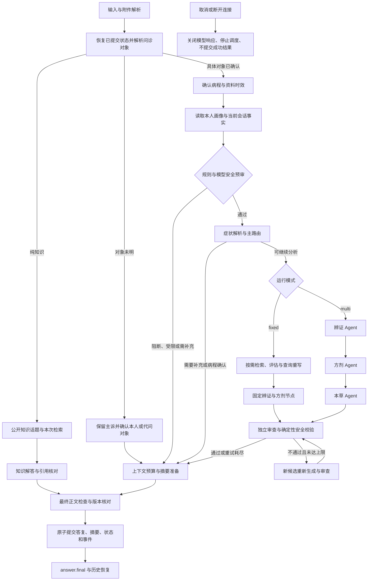

# 岐问问答流程与 Agent

对象解析后先执行 `episode_resolve`，病程管理仅作用于同一会话：明确新问题时归档旧症状，长间隔续问按需确认是否延续。当前风险提示优先于病程确认。成功临床轮次保存会话内有来源的结构化摘要；知识、失败和取消不覆盖临床摘要。跨会话只参考本人手填或明确确认的画像，不生成或召回其他会话的症状摘要。fixed 和 multi 共用事实视图及调用前预算。聊天页面保留已确认画像管理，已移除“问诊信息与记忆”面板。

本文合并问答流程、安全预审、普通症状解析、长期画像确认、候选与剂量协议及取消边界。描述当前实现；历史验收结果见 [evaluation_report.md](evaluation_report.md)，测试入口见 [testing.md](testing.md)。

## 问答流程

API 先校验账号、会话与附件归属，再启动 `backend/app/workflow.py`。页面新会话默认 `multi`，使用三个受限的 LangGraph Agent 子图；顶部可选择固定流程或多 Agent 会诊，也可切换已有会话的后续轮次。生成中禁止切换。API 未指定模式时仍默认 `fixed`，已有消息保留原来的流程记录。



fixed 古籍检索最多尝试 3 次，候选安全修正最多 2 次。每次模型请求前检查系统提示、患者资料、Schema、工具结果和输出预留的预算；末端预算节点仅记录上下文规模，实际保护位于模型调用入口。关键安全事实与未解决问题独立保存。未通过最终审查时隐藏药材清单，提交受限答复。检索细节见 [rag.md](rag.md)。

## Multi LangGraph 子图

纯知识交流在两种模式中共用 `knowledge_search → knowledge_answer` 分支，使用本轮问题、有限的成功知识话题和公开古籍片段；不读取个人画像，不进入辨证、方剂或长期画像写入。真实模型使用 `knowledge` 角色生成受 Schema 约束的解释，出处 ID 必须来自本轮检索，剂量/用法内容不展示。Mock 明确显示检索演示或无资料状态，不冒充真实模型解释。

上传文件单份最多 10 MB、提取文本最多 20000 字符；超出文本上限返回 413，要求拆分，不保存截断版本。一轮最多 5 个附件，全部已接受文本参与安全事实与症状提取，保留换行边界；DOCX 同时提取段落和表格。模型辅助摘录从全文中的事实来源选择，并标明缩短；完整文本仍参与安全预审。早期上传时已被截断的文件需重新上传。

Agent 按辨证 → 方剂 → 本草的证据依赖顺序执行，不是三个专家同时自由对话。各 Agent 使用 `model → tools → model` 条件边循环；模型不再请求工具时进入 `validate → END`，校验结构化产物。真实模型选择允许的工具，Mock 使用确定性规划器运行同一子图。

问诊对象、当前主诉和病程已明确且无待确认的关键安全/症状冲突时，辨证产物因缺舌脉或检索未命中请求补充，不再直接终止整个会诊。流程保留原始产物状态，以初步知识分析范围继续方剂、本草与独立审查；四诊缺项和最关键的待补充问题在末尾展示，不生成个人处方。方剂未形成个人候选时可继续核对实际检索的文献条目，未检索到则如实显示证据不足。正文展示已实际查询且经数据库核对的方剂适应描述、本草性味功效及出处，过滤剂量用法；不能用“分析完成”替代具体内容。病程解析支持“一个星期”等口语，并将单一主诉的明确病程短答绑定到原始用户来源。

网页将已完成的会诊整理为默认展开、可折叠的辨证/方剂/本草摘要卡，下方只展示“辨证结果”和“处方建议”。检索出处、逐项校验日志与待补充清单保留在服务端原始答复及轨迹，不在网页单独展开。本草卡始终保留面向用户的安全警告，归纳过敏、配伍及待复核限制，不暴露内部校验字段。辨证卡显示模型实际返回的0到1自评置信度，注明未经临床校准；缺失时不显示置信度，不用固定百分比补齐。摘要仅说明用户可核对的症状依据与不确定性，不显示内部思维链。未通过安全审查时，“处方建议”明确不能形成可执行个人处方；网页整理不改变后端审查结果或解禁剂量。

| Agent | 允许工具 | 最大模型决策轮数 |
| --- | --- | --- |
| 辨证 | `get_patient_profile`、`search_classics` | 6 |
| 方剂 | `search_formulas`、`lookup_herb`、`get_dosage_evidence`、`check_herb_compatibility` | 8 |
| 本草 | `get_patient_profile`、`lookup_herb`、`get_dosage_evidence`、`check_herb_compatibility`、`check_user_risks` | `min(12, 5 + 药材数)` |

模型轮次、消息、工具结果和重复计数保存在子图状态中，不再另行维护手写 ReAct 调度循环。子图不保存原始模型消息检查点，成功产物和裁剪轨迹仍由外层工作流保存。这里保留了根据工具结果继续决策的行为，不意味着去除工具调用能力。

工具均只读，参数使用严格 Schema；同一工具及参数超过 2 次会产生失败 Observation。每个工具有独立超时，达到轮数上限或结构化结果非法时失败；最终产物也占一轮，同轮多个工具按顺序执行。关键对象、主诉病程或安全资料不明时可返回 `need_user_input` 并追问，常规四诊缺项按上述初步知识分析路径继续。方剂查询支持分开的关键词及已收录症状术语；原查询为空时可按本轮明确症状检索，并在工具结果明确标记回退，不将检索关联写成患者新增事实。Agent 不能跳过外层预审、独立审查、确定性校验与最终版本检查。

最终 JSON 格式或 Schema 不合法时，若尚有决策轮数，仅允许一次格式修正；修正仍占用原来的轮数上限，再次失败就终止。单个 JSON Markdown 围栏可去除后进行同样的严格校验。未通过校验的产物不发布完成事件。

网关原生工具请求失败，或其普通文字结果无法校验时，该轮会诊可切换到真实模型的结构化 JSON 工具决策协议，并在后续专家中沿用。模型仍自主选择已注册工具，工具照常执行并把实际结果送回下一轮；参数、重复限制、超时及产物校验保持一致，不切换 Mock。模型调用记录以 `kind=structured_tool_decision` 标记，Agent 完成轨迹记录 `protocol`。工具决策 JSON 不作为候选正文流出。

兼容协议末尾预留最终产物生成和至多一次格式修正，不再增加工具行动；证据不足时允许请求补充或返回受限结论。单轮可批量选择多个工具，程序仍逐项校验和执行。JSON 包装按实际请求大小预算，较早工具轮次按完整组裁剪，保留患者输入和最新工具组，不突破原上下文与决策轮数上限。

`QIWEN_TOOL_PROTOCOL=auto` 默认先尝试原生协议；`native` 保持原生调用，`json` 直接使用兼容协议。当前本地网关在明确工具调用测试中只返回文字，因此本地选择 `json`，避免每轮先等待原生工具请求失败。

SSE 发布 `agent.action`、`agent.observation`、`agent.completed`，最终 `trace.agents` 保存结构化产物、裁剪后的工具结果和停止原因。不请求、保存或展示模型思维链。

同步只读工具通过工作线程执行，工具超时覆盖等待过程。取消后不接收迟到结果，不提交答复、事实或病程摘要。已经执行中的同步网络读取不能强制终止线程，会在底层超时内结束。

## 安全事实与跨轮预审

每轮先恢复当前会话成功提交的状态，再通过 `subject_resolve` 解析本次对象。初始对象为 `unknown`；登录账号只决定访问权限。“我咳嗽三天”直接确认本人；“咳嗽三天怎么办”先确认本人或代问对象，并保留主诉。确认本人后才读取本人画像与已确认事实；代问仅使用对应对象的会话资料。纯知识交流不读取个人医疗资料，也不清除尚未回答的问诊问题。

`get_patient_profile` 在工具内部执行对象限制；Agent 不提供其他会话的症状检索工具。当前肯定急症优先提示风险，不等待对象确认。提交前检查对象范围、切换序号与状态版本，切换对象不复用之前的候选。`trace.safety` 保留 `subject_confirmed`、`subject_epoch`、`subject_evidence`，顶层 `identity_scope` 绑定候选归属。

会话事实和适用画像直接进入上下文，不依赖检索命中。空过敏字段仍表示未知；明确的“没有过敏”须有用户原文证据。旧默认 self 且未经确认的状态不会自动升级为本人。

安全事实包含 `category`、`entity`、`subject`、`assertion`、`temporal_scope`、`details`、`confirmation`、`source`。消息或附件来源保留原文、位置与采集时间；患者身份不能由登录账号或附件归属推定。

- 否定只作用于对应实体。“没有胸痛，但现在呼吸困难”分别处理；双重否定、疑问与不确定表达不能当作明确否认。
- 当前、既往、已结束和未知分别保存。“现在没有”不能静默抹去旧事件。
- 明确替母亲咨询后，省略主体的回答沿用母亲，不写本人长期画像，也不套用本人手填资料与已确认长期画像。
- 多人描述、附件主体或对象不明时先确认；对象切换分别保存并恢复问诊和安全问题。
- 假设、引用、知识询问与引用模型判断不作为真实自述。模型补充事实必须有本轮原文证据，不能放宽程序结论。

解析器是有限中文规则，不保证识别所有复杂表达。第一版没有完整家庭成员长期档案，同种亲属称呼不能可靠区分多个现实的人。

| 状态 | 行为 |
| --- | --- |
| `needs_info` | 保存问题 ID 与缺失字段，优先提出一个具体问题 |
| `restricted` | 个人用药仍需人工核对；仅有已明确非草药过敏时可继续问诊、辨证和方剂本草文献对照，个人候选不批准、不保存为可用处方 |
| `blocked` | 风险阻断或预审不可用，停止治疗路径 |
| `resolved` | 可继续当前流程，候选仍须独立审查 |

“是”“不是”只绑定适合的唯一问题；“已经结束了”缺少对象或时间时不清除风险；不知道或跳过保留未知。回答后重新预审，资料齐全不自动放行。确认仍在哺乳后不重复同一问题，保持受限。

模型重复提供的、与适用安全事实及来源原文完全一致的 observation 不重复插入；新事实仍须有本轮原文证据。身份确认短答的预审同时接收已保存主诉及对应对象的症状事实。预审调用或校验失败会明确显示服务未完成、可重试，不显示为急症判断。

当前肯定急症、危险配伍、超剂量或自行使用毒性药等已收录风险、绕过安全请求及模型预审失败会阻断相应路径。孕哺、未成年人、合并用药及未覆盖过敏原需补充或人工核对。规则是工程拦截策略，尚不能视为经临床核验的风险标准；`allow` 只表示允许继续流程。

已明确的非草药过敏（如青霉素）单独触发时，预审保留 `clarify/restricted`，以 `analysis_allowed` 允许继续信息收集和受限知识分析。风险与分析边界必须进入每个临床模型的必要上下文。候选剂量清空，确定性校验追加人工复核限制，最终不批准或保存个人处方、不用于后续加药；界面可单独显示由数据库核对来源的方剂文献条目和本草风险说明。其他急症、对象不明、过敏原不明、孕哺、未成年、合并用药等门禁不因此放行。

加药追问只复用同一会话中已通过安全校验且实际展示的方剂知识示例，并把新增药材与已有清单一起检查。没有可用完整清单时先要求补充；被拒绝或隐藏的候选不能成为加药依据。未命中内置规则不能证明适合自行服用。

## 普通症状解析

`backend/app/symptoms.py` 逐次提取症状事实，不新增普通症状模型调用。字段包括 `id`、`symptom`、`subject`、`assertion`、`time_scope`、程度/趋势/时长原文、`correction` 与 `source`。`assertion` 为 `present / absent / uncertain / unspecified`，后者仅描述变化，不能据此确定症状存在。

| 表达 | 程序处理 |
| --- | --- |
| 头痛没有咳嗽 | 头痛肯定，咳嗽否认 |
| 不是没有咳嗽 | 常见明确双重否定按肯定记录 |
| 不能排除咳嗽 | 不确定，先确认 |
| 咳嗽不明显 | 肯定，保留程度原文 |
| 咳嗽没有加重 | 只记录变化，无肯定依据时确认存在性 |
| 没有咳嗽、发热和鼻塞 | 否定延续到并列列表 |
| 以前咳嗽，现在没有咳嗽 | 既往肯定与当前否认同时保留 |
| 咳嗽，没有咳嗽 | 同时间冲突，确认前不进入检索或治疗生成 |

事实位于会话状态的 `symptom_facts`，待确认项位于 `clinical[subject].symptom_pending`。更正保留旧来源并标记替代关系，不同时间事实不相互覆盖。“有”“没有”等短回答仅在明确问题下绑定；不知道或跳过不消除待确认项。

未收录身体不适进入 `pending.kind=mapping` 的原文确认，确认后保留原词与持续时间。附件先确认主体，再保留上传来源。当前患者、当前时间、肯定事实才派生为检索症状；否认、既往和他人信息不加入。症状事实不自动成为长期画像，检索扩展词也不回写事实。

`trace.inquiry` 保存 facts 与 pending。知识问题进入 `chat`，自身症状资料不足进入 `consult`，满足现有规则后进入 `diagnose`；这些是工作流路由标签，不代表已经完成临床诊断。

## 长期画像确认

本轮明确过敏等风险立即参与审查；长期保存需另行确认。长期画像仅接收过敏、自述体质、明确慢性病史或既往诊疗经历，显示内容、来源、时间与冲突。本次头晕、情绪低落等症状、临时用药与孕哺状态不进入长期画像建议，但仍参与本次会话的安全审查。已存在的待处理建议在读取和确认时也执行同一过滤规则。用户可修改、确认本人保存、暂不保存或标为他人；关闭弹窗等同暂不保存，冲突需额外确认更正。

侧栏“既往诊疗记录”可展开查看已确认病史及本人补充的结构化记录；支持新增、修改和删除就诊日期、机构、当时诊断或就诊原因、治疗经过与疗效复诊情况。记录保存在独立的 `medical_records` 表，写入需本人确认及画像 revision，校验归属并在变化后使旧上下文缓存失效。读取本人画像时加载这些记录作为后续问诊资料，不把本轮模型推断自动保存为既往诊断。

候选按类别、对象、断言、时间与反应细节去重；已处理相同建议不反复弹出，新反应细节可补充。未知过敏原照实保留，不声称已完成其候选校验。体质保存为用户自述，不标医学核实。

`patient_safety_facts` 与手填 `profiles` 分开存储，读取时返回有效视图。“已确认画像”可查看来源和撤销；撤销或拒绝长期保存不解除本会话已知风险。新会话需重新核对旧孕哺与用药资料。空白表示未知，明确“无”表示自述否认。

确认 API 校验归属与 revision，批量事务先校验所有项，版本冲突返回 409；同一终态重复确认幂等。聊天建议只在运行成功后创建，确认 API 独立提交。编辑后重新核对冲突，不能改名绕过检查。删除会话不静默删除已确认长期事实。

## 结构化方剂、剂量与审查

知识库、候选、最终消息与前端方剂卡共用结构：

```json
{
  "name": "方剂知识示例",
  "herbs": [{
    "herb_id": "herb:药材标识",
    "name": "药名",
    "dosage": {"min": null, "max": null, "unit": "g"},
    "preparation": "",
    "source_ids": [],
    "verification_status": "unverified"
  }]
}
```

`dosage_evidence` 保存原始剂量、范围、单位、炮制、数据定位、版本和人工核验信息。只解析明确的现代 g/mg/ml 数值，复杂描述与古代单位留空，不做古今换算。无出处数值会被清空并拒绝该候选；自由正文不能夹带剂量或用法，方剂段由 `render_plan` 生成。

审查核对药材标识、已收录名称、重复、配伍、过敏、来源、单位、范围和炮制，分别保存 `compatibility_status` 与 `dosage_status`。模型自称 verified 不被采纳；内置剂量均为 unverified。人工核验来源仍需核验人员、时间、适用人群及当前画像条件匹配，不能据此证明患者适宜用药。

候选审查哈希绑定药名、剂量、单位、炮制、出处与画像；提交前重新核对证据和画像指纹。历史字符串清单迁移为缺失剂量、未核验结构；更早文本只恢复已收录药名，不推断剂量或审批状态，不改写历史正文。

## 候选、模型与取消

候选经历 started → delta → completed → review → approved/rejected。每次修改分配新候选 ID；拒绝版本保存在服务端，普通历史不加载。当前页面展示阶段与 `answer.final` 确认的正文，未通过审查的候选不进入答复气泡；最终结构化方剂卡直接读取持久化数据。

异步模型调用独立超时与有限重试。401、无效 JSON、Schema 不合规不重试；408、429、5xx 和传输异常按上限重试。已经发送部分流片段后失败会终止该轮，不拼接另一轮重试正文；只返回 JSON 的接口不能视为实时模型流。

停止按钮先冻结前端，再请求服务端取消。取消关闭模型响应、停止后续节点与重试，不提交成功答复、摘要、安全事实或画像建议；断开连接执行同类清理。运行状态、已停止记录与轨迹可持久化，下一轮只读最后成功状态。重启把遗留活动运行恢复为已取消。

完成与取消竞争由最终事务决定；已提交结果可刷新恢复，完成后取消无操作。运行管理为单进程，上游是否停止计算和计费需供应商单独验证。本地单批张量推理可能继续至结束，但不能造成取消后的成功提交。

轨迹记录实际节点、耗时、次数、模型角色与可用的 Token 用量；供应商未返回用量时为 null，不能推算计费。模型调用记录不保存密钥与提示正文，消息中的业务事实和来源受归属保护。阶段时间不应简单相加作为总时长。
