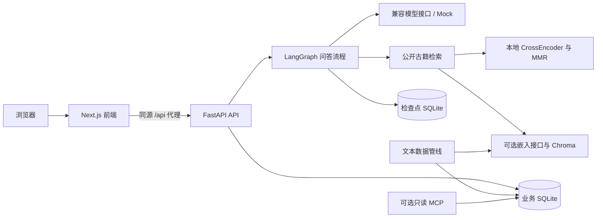

# 岐问架构

上下文由 `context.py` 的 ContextBundle 共用于 fixed 和 multi；`context_budget.py` 在实际模型请求前保护预算。`thread_safety_state` 与 `consultation_episodes` 只保存同会话问诊事实、待答项与病程摘要；`knowledge_topics` 承接同会话公开知识话题。跨会话只使用手填及明确确认的用户画像。旧摘要、向量、词索引与控制表兼容保留，退出生成和召回。`checkpoint_retention.py` 保留最近恢复点及有限排障运行。详见 [context_memory_plan.md](context_memory_plan.md)。

本文描述当前工作区的模块职责。运行步骤见 [deployment.md](deployment.md)，问答节点见 [agent.md](agent.md)，接口契约见 [api.md](api.md)。

## 系统组成

前端使用 Next.js、React、TypeScript、Zustand 和 TanStack Query。后端使用 FastAPI、Pydantic、LangGraph 与 SQLite；真实聊天通过兼容接口调用，默认聊天模式为 `mock`。Docker 使用 Python 3.12 和 Node.js 22，前端依赖由 npm 与 `package-lock.json` 管理。

## 模块职责

| 位置 | 职责 |
| --- | --- |
| `frontend/src/app/`、`components/` | 登录、聊天、侧栏、处理阶段、画像确认与结构化方剂展示 |
| `frontend/src/lib/api.ts`、`backend-contract.ts`、`stream.ts` | 请求、后端字段适配、SSE 解析；正文以 `answer.final` 为准 |
| `frontend/src/hooks/useChat.ts`、`stores/auth.ts` | 对话状态、停止操作、历史恢复与登录状态 |
| `backend/app/main.py`、`auth.py` | API、身份与资源归属、附件解析、最终事务提交 |
| `backend/app/workflow.py`、`agents/` | fixed 节点与 multi LangGraph Agent 子图、路由、重试、上下文预算 |
| `backend/app/runs.py`、`model.py` | 运行管理、取消、事件持久化、异步模型调用与用量记录 |
| `backend/app/safety_context.py`、`safety_store.py`、`preflight.py`、`symptoms.py` | 患者事实、跨轮追问、预审、画像确认与症状解析 |
| `backend/app/safety.py`、`prescription.py` | 药名归一化、配伍与过敏规则、剂量证据和审查指纹 |
| `backend/app/classics.py`、`retrieval.py`、`local_ranking.py`、`terms.py` | 古籍召回、重排、MMR 与有来源的术语扩展 |
| `backend/app/memory.py` | 旧摘要删除与控制版本兼容；无检索和生成入口 |
| `backend/app/db.py`、`corpus_seed.py`、`knowledge_seed.py` | 数据库初始化、幂等升级与种子入库 |
| `backend/data_pipeline/`、`scripts/` | 结构切片、导入、索引、模型缓存、数据快照与服务检查 |
| `backend/app/mcp_server.py`、`profile_access.py` | 可选只读知识工具、本人画像权限与访问审计 |
| `backend/evaluation/`、`backend/tests/` | 六维测评、固定基线与工程回归 |

## 数据与事务

`qiwen.sqlite3` 保存账号、会话、消息、画像、上传记录、古籍、知识种子、运行、候选和事件；`checkpoints.sqlite3` 保存 LangGraph 检查点。Docker 数据位于 `qiwen_data` 命名卷，本地直接运行默认使用根目录 `.data/`。两者不会自动互相同步。

| 数据 | 权威来源与生命周期 |
| --- | --- |
| 当前会话安全与症状状态 | 业务库 `thread_safety_state`；只恢复成功提交的状态，按咨询对象区分 |
| 已确认长期事实 | `patient_safety_facts`；用户确认后生效，变更记入 `safety_fact_events` |
| 历史摘要 | `profile_memories` 仅兼容保留旧数据，不生成、不召回、不注入模型 |
| 病程摘要与知识话题 | `consultation_episodes`、`knowledge_topics`；仅成功提交更新，临床事实和知识话题独立保存 |
| 记忆控制与相关索引 | `memory_controls` 保留旧修订及禁用状态，`memory_terms` 保留旧数据但不再回填或查询 |
| 候选、审查与事件 | `candidates`、`run_events`；拒绝版本独立保存，普通历史读取最终消息 |
| 上传文件 | 数据目录 `uploads/` 与有归属保护的数据库记录 |
| 古籍向量与模型缓存 | 可重建的检索数据与 `models/` 缓存；不能替代业务库中的来源正文 |

最终答复、摘要、安全状态、画像建议、最终候选和 `answer.final` 事件在同一事务中提交，然后发送最终事件。提交前核对患者范围及切换序号、会话状态版本、本人画像版本与指纹、候选审查哈希及知识证据；变化时拒绝旧结果。取消或失败不提交成功答复与新事实。

登录身份只决定资源权限。`subject_resolve` 在读取个人医疗资料前确认当前患者；知识交流使用通用上下文，未知对象先保存主诉并追问，代问使用对应对象的会话状态。其他会话的症状、摘要、附件和待答问题不进入当前问诊；本人长期资料由手填或显式确认产生。第三方资料不写入本人长期画像，家庭成员的跨会话档案仍未实现。

删除会话会清理对应消息、运行、摘要、会话状态与检查点；已确认长期事实保留来源快照，通过撤销接口取消长期保存。旧自由文本不会因升级自动成为已确认医学事实。

## 运行边界

默认 Compose 为一个 Uvicorn 进程，活动运行在进程内协调。同一会话只能存在一个活动运行；增加 worker 或副本前，需要共享运行协调器。同步只读检索在线程中执行，取消不能强行终止已经开始的单批推理，但取消后不能提交成功结果。

默认请求古籍 `hybrid` 检索不代表向量实际成功；健康接口报告的是配置模式，实际通道与降级状态应读取消息轨迹。古籍重排使用本地 CrossEncoder，记忆重排使用独立聊天模型角色，两者协议和失败策略不同，见 [rag.md](rag.md)。

本项目用于学习与研究。工程测试、来源核验与模型评分不能证明医学结论或个体用药安全。
