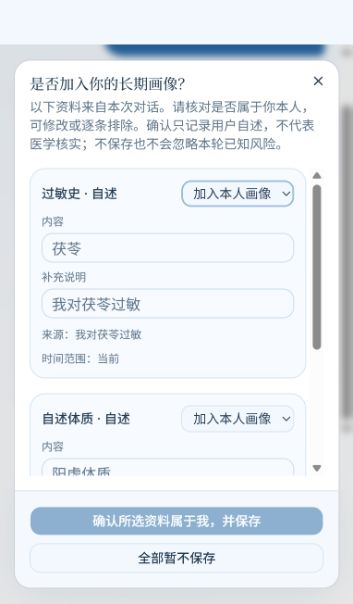

# 安全预审、跨轮状态与长期画像确认

2026-09-27，依据当前自有后端和淡蓝前端编写。原始分阶段方案见[改进计划](安全预审改进计划.md)。

## 每一轮的数据流

1. API 校验账号、会话、附件归属，为运行记录来源消息和上传 ID。
2. memory_load 直接读取本人已确认事实、手填资料和本会话成功提交的安全状态。关键事实不依赖 BM25、向量或 rerank 命中。
3. 检索选中的历史摘要作为带来源的既往线索加入，不能成为已确认画像。
4. pre_safety 解析当前消息与附件，区分主体、肯定/否定/不确定、当前/既往/已结束。明确切换咨询对象时分别保存、恢复问诊和安全追问状态。
5. 将回答绑定到安全问题，再执行规则预审。真实模式增加模型预审，补充事实必须有当前输入的逐字证据，不能放宽程序限制。
6. 未解决问题针对性追问；已确认但需要人工核对的风险保持受限，不调度辨证、方剂和多专家治疗生成节点。
7. 成功完成后原子提交最终答复、摘要、会话安全状态和画像候选。取消、失败或版本变化不提交成功结果。
8. 前端在本轮结束后将候选合并为一个弹窗，用户明确确认归属和内容后才写长期画像。

## 主体、否定与时间

safety_context.py 为事实保存 category、entity、subject、assertion、temporal_scope、details、confirmation、source。

- 登录账号负责权限，不能证明描述属于本人。
- “我对甘草过敏”属于本人自述，“妈妈对甘草过敏”属于母亲。常见同义称呼统一处理。
- 确定替母亲咨询后，省略主体的回答沿用母亲，不加入本人画像，不套用本人手填资料和跨会话记忆。
- 同时描述多个人而对象不明时先确认。身份不明的画像候选在保存前仍要求用户确认。
- “没有胸痛，但现在呼吸困难”分别解析，不因明确否认的胸痛命中肯定规则。
- 双重否定、疑问、不确定表达保持待确认；旧事件不因“现在没有”被静默抹去。
- 假设、常见引用、知识询问和引用模型判断不作为真实自述。
- 附件归属不代表患者身份。附件事实保持主体待确认，记录上传 ID，不直接生成本人保存建议。

解析器覆盖已定义的常见中文表达，不能保证理解所有复杂句子。真实模型可补充有证据的事实；工程测试不能证明普遍语言理解或医学正确性。

## 追问状态

thread_safety_state 位于业务 SQLite，是权威状态；检查点不会覆盖它。关键安全事实不随普通上下文压缩丢弃。

| 状态 | 行为 |
| --- | --- |
| needs_info | 保存问题 ID 和缺失字段，优先提出一个具体问题 |
| restricted | 收到资料但仍需人工核对，不继续自动治疗生成 |
| blocked | 命中阻断或预审不可用，停止治疗路径 |
| resolved | 本次可继续，候选仍独立审查 |

内部收到答案后立即重新预审。“是”“不是”只绑定适合的是非问题。“已经结束了”缺少对象或时间时不清除风险；不知道、跳过保留未知。过敏追问支持“甘草，服用后起疹子”等省略“过敏”字样的回答。

确认仍在哺乳后不重复同一问题，保持 restricted。当前孕哺、未成年人、用药或未覆盖过敏原仍需人工核对。没有新增医学放行标准，allow 不等于诊疗或用药安全。

## 合并弹窗

候选包括过敏、自述体质、既往史、孕哺和当前用药。只有有原始陈述依据、属于本人或待确认、非不确定的事实才提出建议。

弹窗显示内容、说明、来源、时间范围与冲突。可以修改后确认本人保存、逐条暂不保存、选择属于他人，或全部暂不保存。关闭弹窗等同暂不保存，不能默认接受。冲突需要额外确认更正。

去重比较类别、规范化对象、断言、时间范围及反应细节。相同已处理建议不反复弹出，新反应细节可以补充。未知过敏原保留原名，不能声称已经覆盖其候选校验。

patient_safety_facts 与手填 profiles 分开保存，读取返回有效视图。体质标为用户自述，不标医学核实。本轮已知风险即使拒绝长期保存也继续生效。新会话对旧孕哺和用药资料重新核对。

输入框上方“已确认画像”可以查看来源并撤销长期保存；撤销不等于否认本会话风险。侧栏可更正手填过敏史：空白表示未知，明确“无”表示自述否认。

第一版不提供完整家庭成员长期档案。代问对象状态保存在会话中，同种亲属称呼不能可靠区分多个现实的人，应明确说明对象变更。

## API、并发与取消

接口均需 Bearer token，服务端校验归属：

| 接口 | 用途 |
| --- | --- |
| GET /api/profile-suggestions?thread_id=… | 候选、来源、冲突、旧值和画像 revision |
| POST /api/profile-suggestions/resolve | 批量 accept/dismiss/other；接受须 confirm_self=true；冲突须 replace=true；可编辑 entity/details |
| GET /api/profiles/{user_id} | 有效画像、safety_revision、已确认 facts 和摘要 |
| PATCH /api/profiles/{user_id} | 更正手填字段，可携带 revision；对应旧结构化事实标为 superseded |
| DELETE /api/profile-facts/{id}?revision=… | 撤销本人长期事实，保留变更记录 |

批量确认事务先校验所有归属，版本不符返回 409。同一终态重复确认幂等；编辑后重新检查冲突，不能靠改名字绕过检查。确认 API 独立提交；聊天候选只在运行成功后创建。

生成期间画像版本变化，最终版本与指纹检查拒绝旧结果；会话状态版本变化也拒绝旧提交。检查与原子写库之间不异步等待。取消、失败、重启恢复只使用最后成功状态。

safety_fact_events 只记录用户、事实 ID、操作、版本和时间，不复制整段患者文字到运行日志。原文存在有归属保护的业务记录中。

## 升级、删除与恢复

启动幂等创建新表，为 profiles 增加版本、为 chat_runs 增加来源字段。旧文本不自动成为已确认医学事实，保留原账号和会话。

升级前业务库和检查点备份位于 .replica-backup/20260927-before-safety-upgrade/，不进入 Git。

删除会话清理会话状态和候选；已确认长期事实继续保存来源快照，使用撤销接口取消长期保存。删除账号级联清理其事实和审计。

回退代码前保留升级后的业务库，不用旧备份静默覆盖新资料。旧程序不认识新状态，不能继续声称具备本次预审能力。

## 验证与限制

新增后端 test_safety_context.py 覆盖否定、时间、主体、跨轮、短回答、确认/拒绝/更正/撤销、权限、版本和迁移；取消测试增加不提交安全状态和画像建议的断言。

新增前端 ProfileSuggestions.test.tsx 覆盖来源、不自动保存、修改、关闭拒绝、他人排除、冲突确认和迟到结果隔离。

~~~powershell
.venv\Scripts\python.exe -m pytest backend/tests -q -p no:cacheprovider
Set-Location frontend
npm test
~~~

交付前按 AGENTS.md 重建 Docker、检查两项服务健康及 /api/health、/chat，并通过临时账号核对实际页面。

当前服务为 Mock。真实接口协议和异常边界通过模拟测试；未配置真实密钥时，不声称已经验证真实模型提取准确率或临床效果。医学规则仍需专家复核。

### 2026-09-27 工程验收记录

- 后端完整测试：126 通过；前端组件测试：11 个文件、59 项通过。
- 已执行 docker compose up --build -d，包含前端生产构建、类型检查和后端镜像更新；前后端容器均 healthy。
- 部署后 /api/health 与 /chat 均返回 200，health 报告 model_mode=mock、rag_mode=mock。
- 使用临时测试账号核对实际弹窗：同轮合并展示过敏史和体质；冲突项要求单独确认；选中一项保存、另一项暂不保存后，长期画像仅新增已接受事实，来源原文可查看。
- 部署后接口验证：孕哺风险跨轮保留，确认后保持限制且不重复同一问题；明确否定不抹去同句呼吸困难；他人过敏不创建本人画像候选；已确认资料可跨会话读取。
- Windows 本机生产构建因 Google 字体网络请求失败未完成；Docker 内的前端生产构建成功，已更新服务。两者分别记录。

下图使用合成测试资料，不含真实患者信息。手机宽度下资料区域可滚动，底部确认按钮保留；测试账号和会话在验收后清理。

