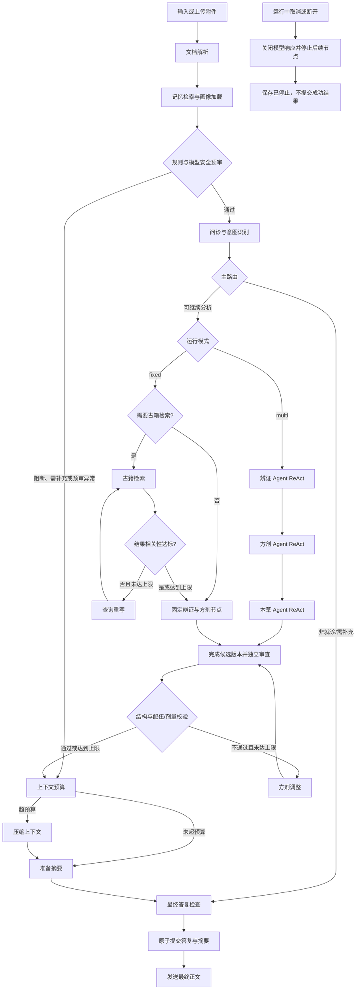

# 岐问问答流程

古籍及新文本导入共用[结构切片流程](古籍结构切片流程.md)：按书籍结构 → 统一清理 → 约 500 字符细分 → MD5 去重 → 业务库保存完整元数据 → 配置嵌入接口后写入 Chroma；问答时读取已有片段。

> 2026-09-26：后端恢复克隆前实现，节点与流程不变。当前淡蓝页面展示阶段和最终正文；摘要管理、结构化核验卡等原前端扩展界面未恢复，不能视为已有页面入口。

记忆读取的后续调整见[会话记忆检索](会话记忆检索.md)：补全查询，按用户隔离执行 BM25/可选向量 RRF 融合及独立模型重排，保留摘要时间与来源，允许不使用摘要。

安全预审的否定识别、跨轮风险、针对性追问和合并弹窗确认已接入；实际规则与边界见[安全预审与画像确认](安全预审与画像确认.md)，原始方案见[改进计划](安全预审改进计划.md)。

普通问诊另已接入[结构化症状事实与歧义确认](普通问诊症状解析.md)：逐条保留否定范围、时间、程度及来源，冲突先确认，当前症状集合由事实派生。

古籍检索已改为[术语扩展、混合召回、CrossEncoder 与 MMR](古籍混合检索与术语扩展.md)：原词保留 → BM25＋向量 → 片段 ID RRF → 本地 CrossEncoder → sigmoid ≥ 0.7 → 候选余弦与 MMR。未收录不适先确认原文，不能猜造古籍症状。

本流程对应用户提供的流程图，后端节点实现在 `backend/app/workflow.py`。`fixed` 保持原有固定节点行为；`multi` 与它共用输入、安全、记忆及底层检索能力，但由辨证 Agent 自主决定是否调用古籍检索工具，再依次运行方剂和本草 ReAct Agent。每个 Agent 可以在自己的允许列表内选择工具、读取 Observation 并决定继续或结束，但不能绕过外层独立审查与确定性安全校验。

## 节点与边界

| 环节 | 当前行为 |
| --- | --- |
| 文档解析 | 上传时解析有归属校验的 PDF、DOCX、UTF-8 TXT；问答节点对提取文本做空白归一化，并限制进入模型上下文的长度。附件中的症状参与问诊。原文件仍保存在用户的上传记录中。 |
| 记忆与画像 | 按用户 ID 读取体质、过敏史、既往史；用当前消息与待追问描述补全查询，检索本人其他会话最近 20 份摘要。BM25 与可选向量结果通过门槛后进行 RRF 融合，最多 3 条，允许为空；摘要保留来源会话与更新时间，当前会话使用近期原文续接。 |
| 前置安全审查 | 按事实识别否定、主体和时间，直接读取已确认资料与会话风险状态。未知资料针对性追问，回答后重新预审或保持受限。当前肯定急症、危险配伍、绕过审查或预审失败停止治疗生成；资料补齐不自动放行。加药仍与同会话已展示方案合并检查。 |
| 主路由与追问 | 按患者与时间保存症状事实，保留肯定/否认/不确定、程度、变化和原文。同时间冲突或主体不明确先问指定问题，确认前不进入检索或治疗生成；当前肯定症状才用于检索。原有简短描述追问继续使用，回复与待补充主诉合并。附件先确认主体，当前不自动判读舌象照片。 |
| RAG 决策与评估 | 用户要求不检索时跳过；否则根据症状/古籍意图检索。BM25 与向量分别召回，按片段 ID 做 RRF，再用本地 CrossEncoder 一次 sigmoid，≥0.7 才进入候选余弦与 MMR。无合格片段时保留原词，逐次加入别名、有出处的古籍词，最多 3 次；不回写患者事实。向量失败退为 BM25；重排失败不引用，MMR 失败仅保留过门槛的相关性排序并明确标记。 |
| 处方安全回路 | 药材、剂量、单位、炮制与出处采用统一结构；独立审查后核对名称、配伍、过敏及出处范围。真实模型最多修正 2 次，每次使用新候选 ID 并重新审查；Mock 不伪造替代处方。最终仍不通过时隐藏药材清单。配伍通过与剂量核验分别保存。 |
| Multi ReAct | 辨证 Agent 可读取画像、检索记忆和古籍；方剂 Agent 可查询方剂、药材、剂量证据和基础配伍；本草 Agent 独立读取画像并检查配伍、过敏、特殊风险和每味药剂量证据。每个 Agent 都有工具白名单、参数 Schema、超时、重复调用和最大步数限制。审查不通过时沿原安全上限退回方剂 Agent。 |
| 多专家会诊展示 | `multi` 按证据依赖顺序执行三个 Agent；候选正文仍标注生成/审核状态。被拒版本清除，最终专家卡随消息保存。剂量卡直接读取结构化数据，种子默认未核验，不提供自行用药指令。候选与最终消息分开保存，恢复历史只读最终消息。 |
| 上下文与档案 | 超过 6000 字符或 10 轮时压缩辅助上下文，安全事实独立保留。答复、摘要、安全状态与画像建议原子提交；新资料合并弹窗确认归属与内容后保存长期事实，可查看来源、撤销。当前没有摘要管理面板，删除会话会删除对应摘要。 |
| 轨迹 | SSE 实际节点开始/完成/取消事件，包含耗时和重试次数；最终保存模型角色、模型、Token 用量和状态，刷新后可查看。预审、取消和提交边界详见[验收说明](模型安全与取消验收.md)。 |

### 加药追问的边界

- 仅保存并复用同一会话中**已通过安全校验、实际展示给用户**的方剂知识示例。升级前的会话可从已展示的回答中恢复示例，仍须重新通过规则检查。未通过校验或隐藏的药材清单不会成为追问依据。
- 例如上一轮“酸枣仁汤”示例含甘草，用户问“可以加海藻吗”，系统将按[深圳市《中药饮片处方审核规范》附录 C](https://wjw.sz.gov.cn/attachment/0/758/758943/8708423.pdf)的十八反条目提示“甘草与海藻”，停止自动开方，建议由开方医师或中药师核对。此规则提示不等于断言服用后一定发生特定不良反应。
- 没有可用方剂时，单味药的加药请求要求提供完整清单；直接询问两味已知药材合用时仍会检查规则。未命中内置规则也不表示适合该用户或可自行服用。

`QIWEN_MODEL_MODE=mock` 默认用于离线流程演示，不能提供个体化诊疗结论。接入真实模型后，辨证和候选方剂使用已配置的兼容接口；确定性安全检查和检索上限仍由程序执行。所有回答只供学习研究，实际诊疗应由有资质人员完成。

## 验证

在 `backend` 目录运行 `..\.venv\Scripts\python.exe -m pytest -q -p no:cacheprovider`。测试覆盖附件进入问诊、按症状追问和否定信息处理、急症提前结束、加药追问及跨会话隔离、三专家卡片持久化与安全隐藏、无需检索、低相关性重写及上限、处方安全重试、上下文压缩、轨迹持久化和跨用户画像权限。前端在 `frontend` 目录运行 `pnpm build`。
