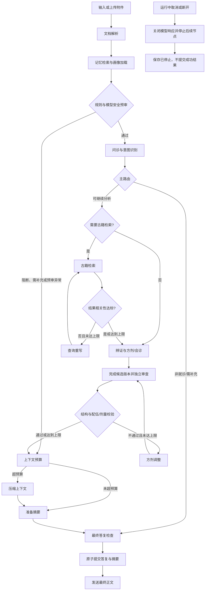

# 岐问问答流程

> 2026-09-26：后端恢复克隆前实现，节点与流程不变。当前淡蓝页面展示阶段和最终正文；摘要管理、结构化核验卡等原前端扩展界面未恢复，不能视为已有页面入口。

本流程对应用户提供的流程图，后端节点实现在 `backend/app/workflow.py`。固定流程和多专家会诊共用输入、检索、安全与记忆环节；多专家模式在证据整理后并行运行辨证、方剂和本草节点，再进行综合与独立审查。

## 节点与边界

| 环节 | 当前行为 |
| --- | --- |
| 文档解析 | 上传时解析有归属校验的 PDF、DOCX、UTF-8 TXT；问答节点对提取文本做空白归一化，并限制进入模型上下文的长度。附件中的症状参与问诊。原文件仍保存在用户的上传记录中。 |
| 记忆与画像 | 读取当前用户手动填写的体质、过敏史、既往史；从同一用户近期会话摘要中按与当前输入的词语重合度选取最多 3 条，并读取当前会话的近期自述。画像只按用户 ID 查询。 |
| 前置安全审查 | 输入或附件命中急症词时给出线下就医提示，停止自动辨证和方剂流程；历史病历含此类词也可能被保守拦截。用户询问能否加药、合用或配伍时，读取本会话上一轮通过安全校验的方剂示例，将所提药材合并做确定性规则检查；命中规则或画像过敏信息即提前输出警告，不进入候选方剂生成。 |
| 主路由与追问 | 无症状的普通问候直接答复；描述过短时按已述症状追问持续时间及相关信息，例如腹胀、大便稀时询问腹痛、口干口苦和舌苔文字描述。下一轮回复与同会话待补充内容合并。用户明确否认的症状单独记录，不列为阳性症状或古籍检索词；信息足够时进入分析流程。当前不自动判读舌象照片。 |
| RAG 决策与评估 | 用户要求不检索时跳过；否则根据症状/古籍意图检索。评估片段是否覆盖已识别症状，相关性低时用古籍近义词重写查询，最多检索 3 次。达到上限仍不足时不展示该批引用。 |
| 处方安全回路 | 药材、剂量、单位、炮制与出处采用统一结构；独立审查后核对名称、配伍、过敏及出处范围。真实模型最多修正 2 次，每次使用新候选 ID 并重新审查；Mock 不伪造替代处方。最终仍不通过时隐藏药材清单。配伍通过与剂量核验分别保存。 |
| 多专家会诊展示 | 多专家并行执行；候选正文实时显示且标注生成/审核状态。被拒版本清除，最终专家卡随消息保存。剂量卡直接读取结构化数据，种子默认未核验，不提供自行用药指令。候选与最终消息分开保存，恢复历史只读最终消息。 |
| 上下文与档案 | 超过 6000 字符的保守上下文预算，或当前会话超过 10 轮用户输入时，压缩辅助上下文。随后按会话保存用户提供的症状与附件摘要，供后续会话读取；不自动修改手填的过敏史、体质或既往史。用户可在画像弹窗中查看、删除摘要，删除会话也会删除对应摘要。 |
| 轨迹 | SSE 实际节点开始/完成/取消事件，包含耗时和重试次数；最终保存模型角色、模型、Token 用量和状态，刷新后可查看。预审、取消和提交边界详见[验收说明](模型安全与取消验收.md)。 |

### 加药追问的边界

- 仅保存并复用同一会话中**已通过安全校验、实际展示给用户**的方剂知识示例。升级前的会话可从已展示的回答中恢复示例，仍须重新通过规则检查。未通过校验或隐藏的药材清单不会成为追问依据。
- 例如上一轮“酸枣仁汤”示例含甘草，用户问“可以加海藻吗”，系统将按[深圳市《中药饮片处方审核规范》附录 C](https://wjw.sz.gov.cn/attachment/0/758/758943/8708423.pdf)的十八反条目提示“甘草与海藻”，停止自动开方，建议由开方医师或中药师核对。此规则提示不等于断言服用后一定发生特定不良反应。
- 没有可用方剂时，单味药的加药请求要求提供完整清单；直接询问两味已知药材合用时仍会检查规则。未命中内置规则也不表示适合该用户或可自行服用。

`QIWEN_MODEL_MODE=mock` 默认用于离线流程演示，不能提供个体化诊疗结论。接入真实模型后，辨证和候选方剂使用已配置的兼容接口；确定性安全检查和检索上限仍由程序执行。所有回答只供学习研究，实际诊疗应由有资质人员完成。

## 验证

在 `backend` 目录运行 `..\.venv\Scripts\python.exe -m pytest -q -p no:cacheprovider`。测试覆盖附件进入问诊、按症状追问和否定信息处理、急症提前结束、加药追问及跨会话隔离、三专家卡片持久化与安全隐藏、无需检索、低相关性重写及上限、处方安全重试、上下文压缩、轨迹持久化和跨用户画像权限。前端在 `frontend` 目录运行 `pnpm build`。
